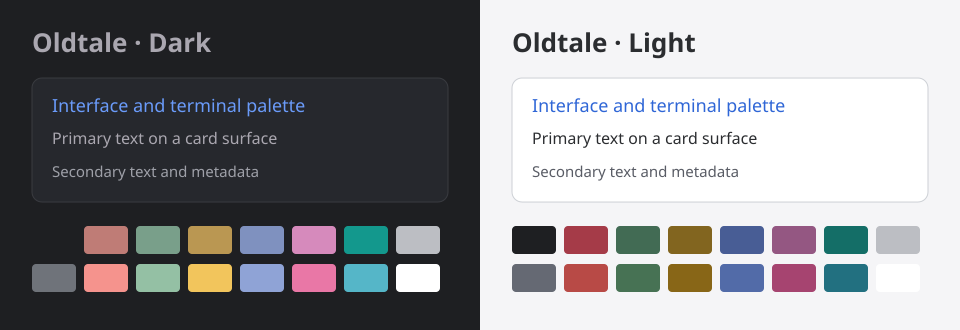

# Oldtale Theme for BB

Oldtale colors for the BB interface, terminal, and code, with dark and light modes.
This plugin adapts [WebStorm OldTale Dark](https://github.com/briginas/webstorm-oldtale-dark-theme) for [BB](https://getbb.app).



The preview shows palette samples, not an application screenshot.
Dark mode uses graphite surfaces and the original Oldtale terminal and code colors.
Light mode uses a companion interface and terminal palette with `github-light` code colors.

## Install

Requirements: BB 0.46.0 or later, Plugin SDK 0.6.37 or a compatible 0.6.x version, and npm on PATH.

Install the latest compatible 1.x release:

```sh
bb plugin install 'git:https://github.com/briginas/bb-plugin-oldtale-theme.git@^1.0.0'
```

Then select the palette:

```sh
bb theme set plugin:oldtale-theme:oldtale
```

You can also select **Oldtale** under Settings → Appearance.
Choose light or dark mode separately in Appearance.
Installation adds the palette without changing the current selection.

The plugin ID is `oldtale-theme`.
The palette ID is `plugin:oldtale-theme:oldtale`.

## Update

```sh
bb plugin update oldtale-theme
```

The release range keeps updates within version 1.x.

## Move from the standalone theme

Install the plugin and select `plugin:oldtale-theme:oldtale` with the commands in **Install**.
The plugin and the custom palette `oldtale` use different IDs, so they can coexist.
The plugin preserves the existing CSS and dark code colors.

After you select the plugin palette, you can delete the old `oldtale` folder inside `bb theme dir`.
Keep that folder until you finish the switch.

## Return to the default theme

```sh
bb theme reset
```

To remove the plugin after the reset:

```sh
bb plugin remove oldtale-theme
```

## Development

```sh
git clone https://github.com/briginas/bb-plugin-oldtale-theme.git
cd bb-plugin-oldtale-theme
npm ci
npm run check
```

The checks cover TypeScript, the BB plugin build, packaged assets, and preservation of the original code and ANSI colors.
The project pins Plugin SDK 0.6.37 and the BB build CLI 0.46.0.
The build emits the server bundle and metadata under `dist/`.
Git installations build from source through the installed BB CLI.

For a local installation:

```sh
bb plugin install .
bb theme set plugin:oldtale-theme:oldtale
```

After CSS or JSON changes, reload the plugin:

```sh
bb plugin reload oldtale-theme
```

Use [Theme Preview](https://getbb.app/marketplace/theme-preview) to inspect both modes, components, diffs, and contrast measurements.

## Source and license

The source theme is fixed at commit
[`e96caad130033e5ec6b72d8aa91c7a138bc34116`](https://github.com/briginas/webstorm-oldtale-dark-theme/tree/e96caad130033e5ec6b72d8aa91c7a138bc34116).
See [UPSTREAM.md](UPSTREAM.md) for the adaptation details and original file.

MIT licensed. See [LICENSE](LICENSE) and [THIRD_PARTY_NOTICES.md](THIRD_PARTY_NOTICES.md).
