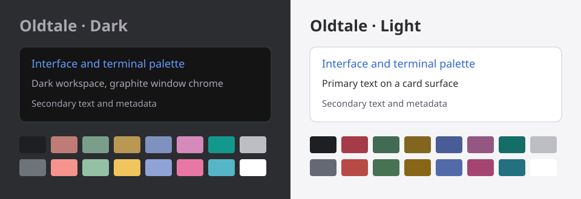

# Oldtale Theme for BB

Oldtale colors for the BB interface, terminal, and code, with dark and light modes.
This plugin adapts [WebStorm OldTale Dark](https://github.com/briginas/webstorm-oldtale-dark-theme) for [BB](https://getbb.app).



The preview shows palette samples, not an application screenshot.
Dark mode uses graphite surfaces and the original Oldtale terminal and code colors.
Light mode uses a companion interface and terminal palette with `github-light` code colors.
Both modes use Dusty Rose (`#c56584`) for send buttons and a thin underline on the active panel tab.

## Install

Requirements: BB 0.46.0 or later, Plugin SDK 0.6.37 or a compatible 0.6.x version, and npm on PATH.

From the monorepository directory, install the local plugin:

```sh
bb plugin install path:. --plugin oldtale-theme
```

After the monorepository is published on GitHub, install from the main branch:

```sh
bb plugin install git:https://github.com/briginas/bb-plugins.git@main --plugin oldtale-theme
```

After a release tag is published, install the latest compatible `0.1.x` release:

```sh
bb plugin install 'git:https://github.com/briginas/bb-plugins.git@^0.1.0' --plugin oldtale-theme --tag-prefix oldtale-theme/
```

Then select the palette:

```sh
bb theme set plugin:oldtale-theme:oldtale
```

You can also select **Oldtale** under Settings → Appearance.
Choose light or dark mode separately in Appearance.
Installation adds the palette without changing the current selection.

The plugin ID is `oldtale-theme`.
The palette ID is `plugin:oldtale-theme:oldtale`.

## Composer

Send actions keep the Dusty Rose accent.
While a reply is running, the empty follow-up composer shrinks to one line.
Typing a follow-up or starting voice input restores the expanded composer.
Turn this off with **Сворачивать пустой ввод во время ответа** in the plugin settings.

Pending work rows use a pixel-grid loader by default.
The **Индикатор ожидания** setting offers `drive`, `dots`, `orbit`, `coins`, and `bb` (the native icon).
Coins use a local CSS Paint Worklet and fall back to the grid when unavailable.
Reduced-motion preferences stop the loader animation.
Both features use Oldtale colors and work without Beautiful Chat.

Keep Beautiful Chat disabled during local development to inspect Oldtale independently.
See [BEAUTIFUL_CHAT_MIGRATION.md](BEAUTIFUL_CHAT_MIGRATION.md) for feature decisions and the local verification workflow.

## Sidebar cards

**Карточки чатов в левой панели** is enabled by default in the plugin settings.
Each card shows the title above its Git branch, the update age beside the native status,
and the provider icon in the lower right corner.
The branch comes from the thread's environment. Threads without a branch leave that line blank.
Times use compact units: `m` for minutes, `h` for hours, and `d` for days.
The cards use the sidebar font settings and work in both Oldtale modes.

Turn the setting off to restore the native rows immediately:

```sh
bb plugin config oldtale-theme set sidebarCards false
```

This layout follows the supplied screenshot. It uses BB's live sidebar SDK data and decorates
the existing rows, preserving navigation, status indicators, menus, and drag behavior.
It respects the thread list's provider-icon preference.
BB's row markup is not a public contract; if it changes, the cards may need an update.

## Font settings

Open **Plugins → Installed plugins → Oldtale Theme → Settings**.
Choose font sizes by area: **code, left sidebar, messages, composer, and the rest of the interface**.
Each area has its own size in **px** and line height in **em**.
For example, a size of 16 px with a line height of 1.5 em gives a 24 px line.
Changing one area does not change the other areas. Utility tiers such as XS and XL are not settings.

Four more fields set the font families for the interface, code, serif text, and terminal.
Enter one installed font family per field, for example `CodeNewRoman Nerd Font`, `Menlo`, or `Arial`.

The defaults are 14 px for code and the sidebar, and 15 px for the other areas.
Code sizes accept 8–18 px. Other areas accept 8–64 px.
BB fixes file-viewer and diff rows at 18 px. The code size limit keeps those rows readable without breaking virtual scrolling or selection.
The code line-height field applies to code in messages; file and diff row heights stay at 18 px.
The separate File Editor (Monaco) plugin controls its own editor size; these settings cover code in messages and read-only source/diff viewers.
Other line heights accept 0.5–4 em, including decimal values.

The default family is **CodeNewRoman Nerd Font** for all four fields.
If that font is unavailable on a client, the theme uses the monospace fallback.

Settings apply immediately in every connected client while Oldtale is active.
They persist across plugin reloads and do not affect other palettes or the window zoom.
The terminal family follows its own field. BB controls the canvas terminal size separately.

You can also use the CLI:

```sh
bb plugin config oldtale-theme set codeFontSize 16
bb plugin config oldtale-theme set sidebarFontSize 16
bb plugin config oldtale-theme set messageFontSize 18
bb plugin config oldtale-theme set messageLineHeight 1.6
bb plugin config oldtale-theme set uiFont 'CodeNewRoman Nerd Font'
bb plugin config oldtale-theme set codeFont 'Menlo'
```

## Update

```sh
bb plugin update oldtale-theme
```

The release range keeps updates within version `0.1.x`.
Each release uses a tag such as `oldtale-theme/v0.1.0`.

## Move from the standalone theme

Install the plugin and select `plugin:oldtale-theme:oldtale` with the commands in **Install**.
The plugin and the custom palette `oldtale` use different IDs, so they can coexist.
The plugin preserves the existing CSS and dark code colors.

After you select the plugin palette, you can delete the old `oldtale` folder inside `bb theme dir`.
Keep that folder until you finish the switch.

## Return to the default theme

```sh
bb theme reset
```

To remove the plugin after the reset:

```sh
bb plugin remove oldtale-theme
```

## Development

```sh
git clone https://github.com/briginas/bb-plugins.git
cd bb-plugins/plugins/oldtale-theme
npm ci
npm run check
```

The checks cover TypeScript, the BB plugin build, packaged assets, and preservation of the original code and ANSI colors.
The project pins Plugin SDK 0.6.37 and the BB build CLI 0.46.0.
The build emits the server bundle and metadata under `dist/`.
Git installations build from source through the installed BB CLI.

For a local installation:

```sh
bb plugin install .
bb theme set plugin:oldtale-theme:oldtale
```

After CSS or JSON changes, reload the plugin:

```sh
bb plugin reload oldtale-theme
```

Use [Theme Preview](https://getbb.app/marketplace/theme-preview) to inspect both modes, components, diffs, and contrast measurements.

## Source and license

The source theme is fixed at commit
[`e96caad130033e5ec6b72d8aa91c7a138bc34116`](https://github.com/briginas/webstorm-oldtale-dark-theme/tree/e96caad130033e5ec6b72d8aa91c7a138bc34116).
See [UPSTREAM.md](UPSTREAM.md) for the adaptation details and original file.

MIT licensed. See [LICENSE](LICENSE) and [THIRD_PARTY_NOTICES.md](THIRD_PARTY_NOTICES.md).
